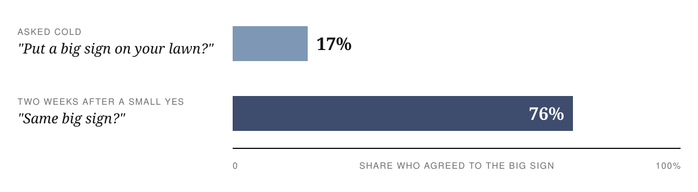
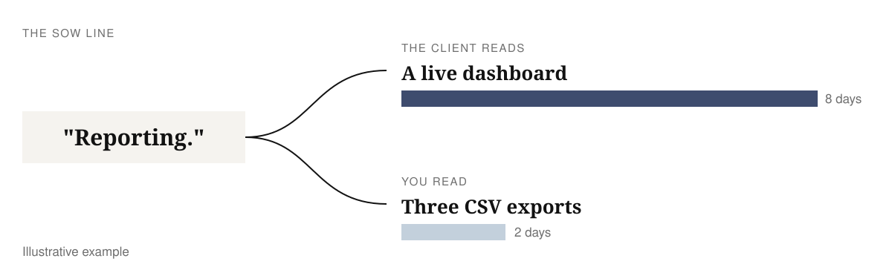
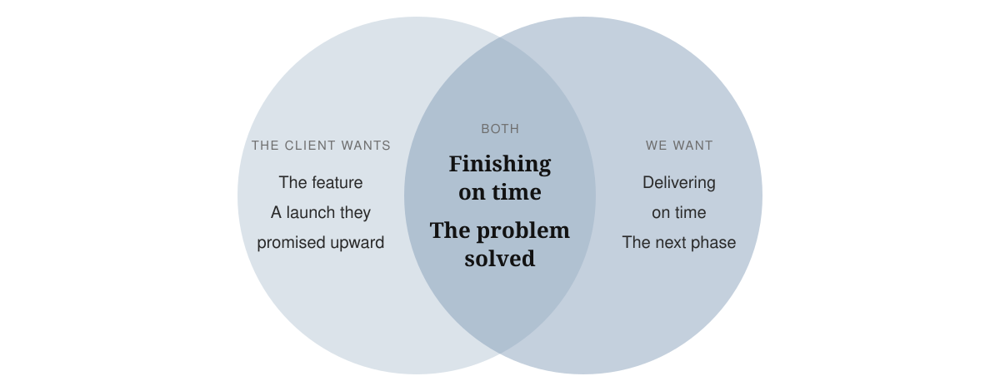
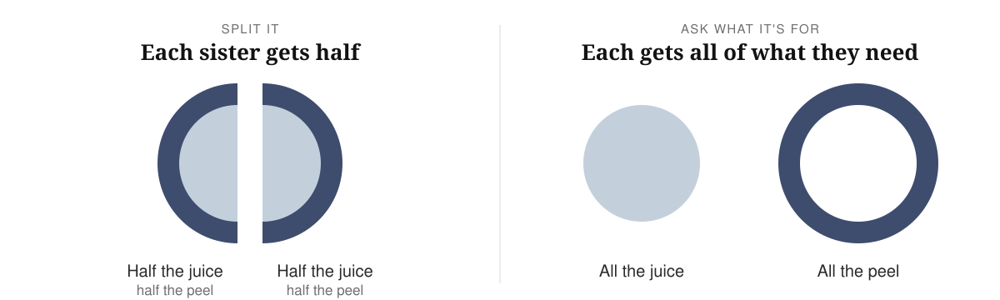
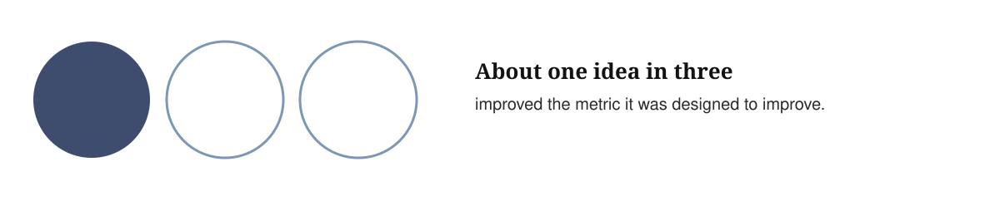
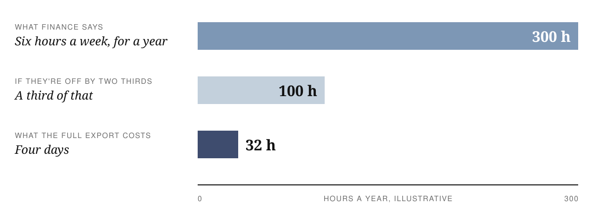
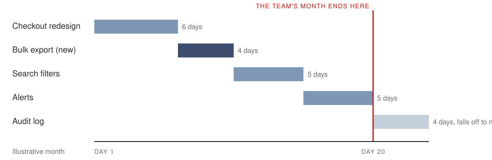
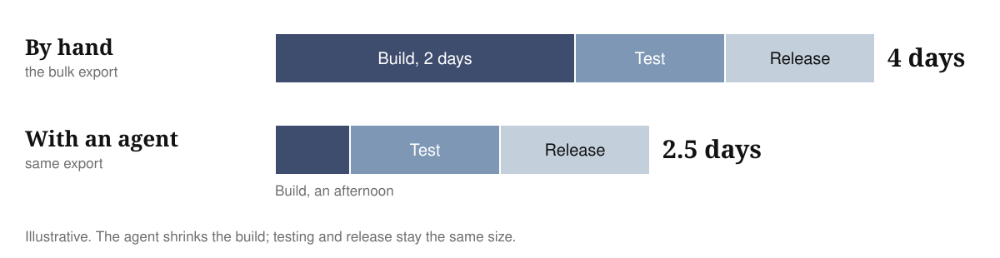

# The one about scope creep

Scope grows on every software project. You can still ship on the date you agreed if you deal with each new ask while it's small.
{: .c-subtitle}

Ten minutes before the end of a weekly call, the sponsor unmutes: "Can we add a bulk export? Should be quick."

I made this one up, but you've heard something like it. It sounds small, so the easy answer is yes. But "quick" is a guess, and the bulk export turns out to be four days of work. Those four days have to come from somewhere, and if nobody decides where, they come out of the end of the project. Say yes to a few of these and the launch date you promised slips, one small yes at a time.

Last week I gave a talk at work on what to do in that moment, for the people who run our client projects. I called it *The one about scope creep*, after the way every [Friends](https://en.wikipedia.org/wiki/Friends) episode is titled "The One Where…". We work fixed price or on monthly retainers, and either way, once we've agreed a scope and a date, a slip because the scope grew is on us.

Managing scope doesn't mean saying no to everything, or yes to everything. It means keeping the launch date you agreed, by making the cost of each new ask clear while it's still small.
{: .c-key}

In this post

1. [Why scope grows](#why-scope-grows)
2. [Pushing back is part of the job](#pushing-back-is-part-of-the-job)
3. [Start with no](#start-with-no)
4. [Ask what the request is for](#ask-what-the-request-is-for)
5. [Do the arithmetic](#do-the-arithmetic)
6. [Absorb, swap or extend](#absorb-swap-or-extend)
7. [Write the decision on one page](#write-the-decision-on-one-page)
8. [When agents write the code](#when-agents-write-the-code)
9. [Common questions](#common-questions)
10. [Five phrases to retire](#five-phrases-to-retire)

### Why scope grows

Scope creep happens on every software project, so expect it from day one.

Software is hard to describe before it exists. The requirements are written before anyone has used a working screen, so they can't cover everything. Building it turns up what nobody thought of. There's an edge case, or an integration that doesn't behave the way the docs say, or data messier than anyone admitted. And the client learns what they want by seeing it. The first demo always produces new ideas, because now there's something real to react to. Ryan Singer wrote this in Shape Up:

> Scope grows naturally. Scope creep isn't the fault of bad clients, bad managers, or bad programmers. Projects are opaque at the macro scale.
{: .fact}

Ryan Singer, [Shape Up](https://basecamp.com/shapeup/3.5-chapter-14), chapter 14
{: .cite}

Nobody knows the whole job on day one. That's the law of the game, so plan for it instead of being surprised by it every few weeks.

**Two of our own habits make it worse:**

1. **Small yeses.** In 1966, Jonathan Freedman and Scott Fraser asked homeowners in California to put a big, hideous "Drive Carefully" sign on their front lawn. Another group was first asked for something tiny: a small "Be a safe driver" sign in the window. Two weeks later, the researchers came back to both groups with the big sign:

   

   Freedman & Fraser, [Compliance without pressure: the foot-in-the-door technique](https://pubmed.ncbi.nlm.nih.gov/5969145/), 1966
   {: .cite}

   Scope goes down the same slippery slope. Say yes to four small changes and the fifth, bigger one feels normal, to you and to the client.

2. **Each side reads the agreement in their own favour.** Every project has some written agreement about scope. For a consultancy, it's the SoW with the client. Inside a product team, it's the spec or the ticket from the product manager. Kent Beck and Dave Cleal [spotted this back in 1999](https://web.archive.org/web/20070810142557/http://www.syntropy.co.uk/papers/optionalscope.pdf) in fixed-scope contracts. The client reads every requirement "as broadly as possible", while the supplier reads it "as narrowly as possible". A product team does the same thing with a ticket. The product manager reads it as the feature they pictured, and the engineer reads it as the smallest change that closes it. Nobody is acting in bad faith. Each side reads the same words the way that makes most sense from where they sit.

   Say the SoW has a line that says "Reporting." You read three CSV exports, and the client reads a live dashboard. Both readings are honest, and they're weeks of work apart.

   

   You can argue about what the SoW meant till the cows come home and you won't resolve it. Agree that both readings are fair instead: "I can see why you read it that way. We read it as exports. Let's price the dashboard and decide what it replaces."

You can't stop the asks, but you can decide how you handle one on the call.

### Pushing back is part of the job

There are two ways to work with a client. A **vendor** takes the list of features and builds what's on it. If an ask comes in, a vendor adds it to the list, and explains at the end why the date slipped. A **partner** starts from the problem. They ask what the list is meant to solve, what each item will take in time and money, and what it's worth, and they keep the date they promised.

Marty Cagan draws the same line inside product companies, between [feature teams and product teams](https://www.svpg.com/product-vs-feature-teams/). A feature team is handed a roadmap of features and judged on shipping them. A product team is handed a problem and trusted to find the best way to solve it, and it's judged on whether the problem went away. Clients hire a consultancy for that judgement, and product managers want it from their engineers too.

So pushing back is part of the job, and we don't stop at no. Done well, the client doesn't hear it as a fight, because you keep going until you find a version that works for both of you.

That version exists more often than you'd think, because you both want the date. It's easy to assume the client wants the feature and only you care about the deadline. Their launch hangs off it too, their sponsor has already promised it to someone above them, and an earlier launch brings their revenue forward. So ask what the smallest version is that solves their problem and still ships on time.

It helps to know where our own incentives sit. On a fixed price, every extra week comes out of our margin, and on a retainer the same team costs the same every month, so going slow never pays us. You don't need to say this to the client. They'll see it when every pushback arrives with a way to hit the date.

### Start with no

37signals has a chapter in [Getting Real](https://basecamp.com/gettingreal/05.3-start-with-no) called "Start With No". I use it on every ask. Back to the sponsor and the bulk export:

> "Not in this scope. Tell me what it's for, and I'll come back tomorrow with what it would take."
{: .pull}

A bare no feels like hitting a wall. The rest of the sentence gets you what the ask is for, so you can check it's the right fix, and a day to think. You don't have to say yes in the same moment, even if you want to. Like any negotiation, if you open at no, you'll end up somewhere sensible in the middle.

### Ask what the request is for

Two sisters want the same orange. They argue, then cut it in half. One squeezes her half for juice and throws away the peel. The other grates her peel into a cake and throws away the fruit. If either had asked what the other wanted it for, both could have had all of what they needed.

The story is old, and [the research behind it](https://www.kellogg.northwestern.edu/faculty/research/detail/1990/social-perception-in-negotiation) holds up. Negotiators walk in assuming the other side wants the opposite of what they want, and many accept worse deals because of it.

Scope asks work the same way. Clients ask for a solution because it's the easiest way to describe what they need, and you're the one who was hired to know what software can do. A few made-up examples:

| They ask for | What's going on |
|---|---|
| One more column on this table. | The ops team is having a nightmarish time finding who owns an order. |
| A full audit log. | A compliance review needs one report a quarter, not the whole shebang. |
| A dashboard for the sales team. | Managers want one number every Monday. |

So what was the bulk export for? Finance matches orders by hand every Monday morning. There's a smaller fix: a weekly summary email with the totals they reconcile against. In our story that's one day of work instead of four.

### Do the arithmetic

Next, ask the product owner what solving it is worth. That could be hours saved, money made or risk removed. A rough number is fine. Finance says the export would save them about six hours a week.

Take that with some salt. Ronny Kohavi's team tested ideas with controlled experiments at Microsoft:

Kohavi, Crook & Longbotham, [Online Experimentation at Microsoft](https://exp-platform.com/Documents/ExPThinkWeek2009Public.pdf), 2009
{: .cite}

Product owners lean towards a rosy future, and so do we. But run the numbers anyway (all illustrative). Six hours a week is about 300 hours a year. The full export is four days, about 32 hours. Even if finance is off by two thirds, that's 100 hours a year against 32. On value, it's an easy yes.

So decide what it pushes out, and whether the one-day email gets most of the value now.

### Absorb, swap or extend

Every ask ends in one of three places. You **absorb** it and something slips, usually the date. You **swap** it for something of the same size. Or you **extend**: more time, more money, or both.

On a fixed price, absorbing comes straight out of your margin, so it's easy to see. A retainer hides it. The client pays a monthly fee for a team and nobody counts hours, so it's tempting to think scope doesn't matter there. But every ask you quietly absorb sets a precedent for how fast the team works and how much fits in a month.

So start with no there too, and make the swap visible. Put the export on the Gantt chart next to this month's checkout redesign, search filters, alerts and audit log. Then show the client which one falls off the end of the month. Now the question is which one they want more, and they can answer that in a minute.

### Write the decision on one page

Whatever happens, write the ask down on one page, the same day. I write it in this order, with the decision at the top:

1. **The recommendation and the decision**, with the name of whoever made it: weekly summary email now, full export next phase.
2. **The options**: absorb (the date slips four days), swap (the audit log moves to the next milestone), extend, or the smaller version.
3. **What it costs**, all of it: two days to build, a day to test, a day to release. It's easy to [size only the code](/posts/software-estimation#3-estimating-the-code-not-the-project) and forget everything around it.
4. **What it's worth**: about six hours a week.
5. **The problem**: finance matching orders by hand every Monday.
6. **The ask**, in the client's words.

The recommendation sits on top because the sponsor reading it has two minutes. That's Barbara Minto's [pyramid principle](https://en.wikipedia.org/wiki/Barbara_Minto): put the answer first, then the reasons.

Write it even when no decision is needed. It keeps your side of the road clean. Over a project, these pages add up to every yes, every no and every swap, and when someone asks at the end whether you could have been faster, that's what you open.

In our story, the sponsor took the weekly email that week and moved the full export to the next phase. Finance stopped reconciling by hand, and the launch didn't move.

### When agents write the code

Agents write a lot of our code now, which is the part the older research doesn't cover. With an agent, the export's two days of build can drop to an afternoon. The test day and the release day don't. So every ask looks smaller than it used to, and saying yes starts to look free.

Sometimes it's worth doing on the spot. A client who asks on Tuesday and has it on Wednesday tells that story to their boss, and that's worth more than most status reports. The agent only writes the code, though. Review, tests, release, docs and upkeep still take the time they took. It's the same rule I use when estimating: [apply the AI speed-up to the build work only](/posts/software-estimation#estimating-for-an-ai-native-sdlc), never to the whole project. Getting Real calls these [hidden costs](https://basecamp.com/gettingreal/05.4-hidden-costs): every feature you add is one you look after for the life of the product.

Half-hour changes add up the same way the small yeses did in the lawn-sign study. Put each one on the record too, even the tiny ones, and tell the client when you've done one beyond the plan. On the day an ask tips you over, you can show them the list and say this one needs a decision. Put the list in your weekly update as well, so the client sees what they got on top of what they paid for.

### Common questions

#### "Won't saying no all the time hurt the relationship?"

It can, if it's always the same person saying it. Teams that work with a client every day get close, and it's hard to keep saying "no, but" to people you like.

So let someone else be the bad cop sometimes: "I'd love to do this, let me check with my lead whether we can fit it in." It keeps you on the client's side of the table and gives the ask a day to cool.

A colleague shared a version from their consulting days, with four steps:

1. **Deny** it at first.
2. **Defer** it to whoever decides.
3. **Delay** it if the timing is wrong.
4. If it still matters after all that, **do** it, as a change request. By then the change request surprises nobody. The fifth D is the one to avoid: never dismiss an ask. Even when you can see straight away it won't help, take it in and come back with a reasoned answer.

#### "What if the client doesn't know what they want until they see it?"

Often they don't, and that's the opacity from the start of this post. I don't have a neat answer, but you can move the seeing earlier. A clickable prototype or a quick demo lets the client react before you build, for a fraction of the cost of a rebuild.

Dig deeper before the build starts, too. Clients know what they need, but they find it hard to say, and pulling it out is our job. Ask who, what, when, where, why and how, and keep asking. Better still, sit with the people who'll use the software and watch how they work today. Once you understand the current process, designing the new one gets much easier. There'll still be a little squiggling around to find the right path, and that's fine. The aim is to avoid a big change of direction in month three.

### Five phrases to retire

These are the five I hear most on calls, and what to say instead.

  

    Instead of
    
"Sure, we'll squeeze it in."

    
"Yes, and here's what it moves." The work goes somewhere: scope, the date or the cost.

  

  

    Instead of
    
"Should be quick."

    
"Let me size all of it." Quick is a guess made before anyone has thought about testing or release.

  

  

    Instead of
    
"That's out of scope."

    
"Not in this scope. What's it for?" The first version ends the conversation, and the client stops telling you what they need.

  

  

    Instead of
    
"We'll try to fit it in."

    
"Here are three options, and I'd pick this one." The client chooses with the trade-offs in front of them.

  

  

    Instead of
    
"No problem."

    
"Who signs off on this?" Sometimes it really is no problem. If it changes the plan, someone should own that change.

  

A lot of this is psychology, but it works in practice. Back to the sponsor's call: the problem behind the bulk export was finance's Monday morning, and a one-day email fixed it without moving the launch. Asking what it's for usually turns up a smaller fix like that. When it doesn't, get someone to decide while the ask is still small, and write down who.

So the next time someone says "should be quick", write down four things before you answer:

`problem, worth, cost, decision`
{: .pull}

### The slides

Here's the deck from the talk. Use the arrow keys or click to move through it, and press `N` for the speaker notes. You can also [open it full screen](/assets/scope-creep/deck.html).

  <iframe src="/assets/scope-creep/deck.html" title="The one about scope creep, slide deck" loading="lazy" style="position: absolute; inset: 0; width: 100%; height: 100%; border: 0;" allowfullscreen></iframe>

