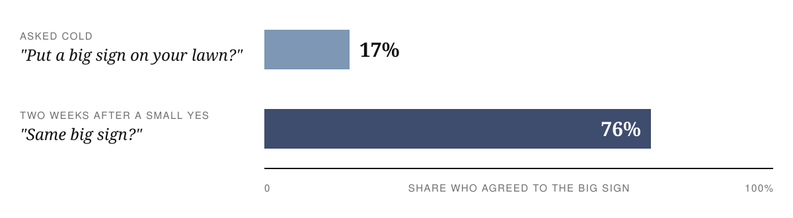
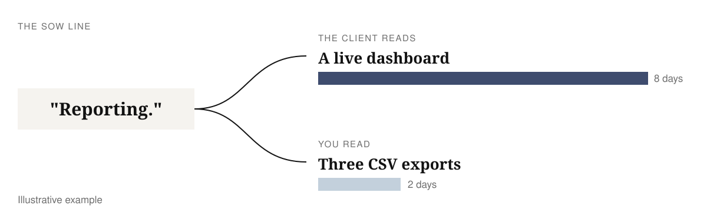
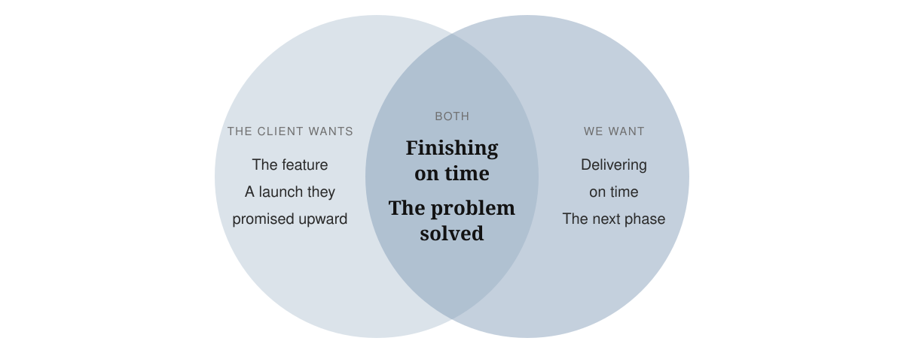
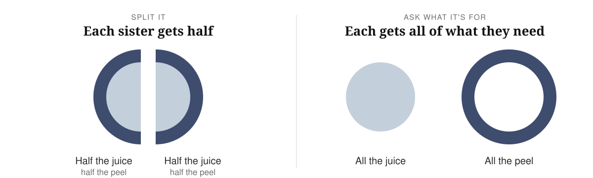
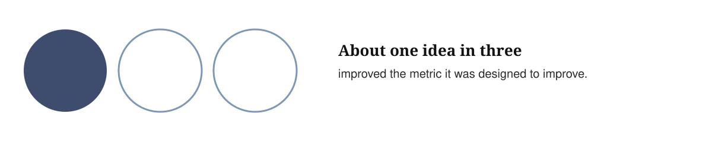
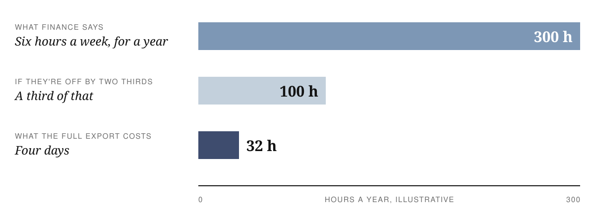
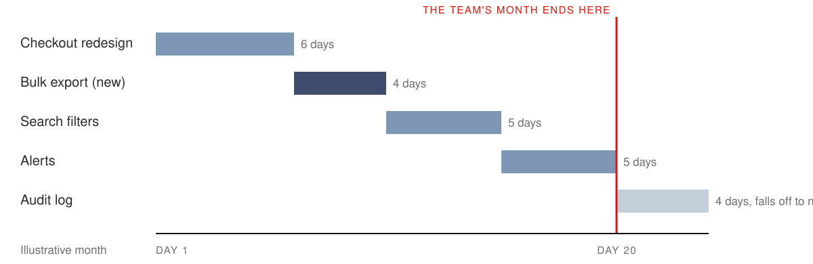
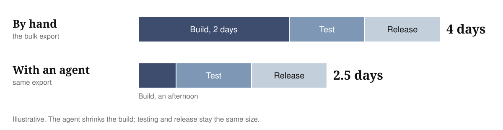

# The one about scope creep

Why scope grows and gets out of hand, five steps for every new ask, and what changes when agents write the code
{: .c-subtitle}

Ten minutes before the end of a weekly call, the sponsor unmutes: "Can we add a bulk export? Should be quick."

I made this one up, but you've heard something like it. It sounds small, so the easy answer is yes. But "quick" is a guess, and the bulk export turns out to be four days of work. If nobody plans for those four days, the project finishes four days late. Say yes to a few of these and the launch you promised slips, one small yes at a time.

I gave a talk at work on what to do in that moment, for the people who run our client projects ([the slides](#the-slides) are at the end). Once we've agreed a scope and a date with a client, a slip because the scope grew is on us. The same moves work inside a product company. I'll say "client" for whoever is asking. On a product team, that's the product manager or the stakeholder behind them.

Managing scope isn't saying no or saying yes. It's finding out what each ask is for and what it costs while it's still small, so you can trade for it and finish on time.
{: .c-key}

In this post

1. [Why scope grows](#why-scope-grows)
2. [Why scope gets out of hand](#why-scope-gets-out-of-hand)
   - [Small yeses add up](#1-small-yeses-add-up)
   - [Each side reads the agreement their way](#2-each-side-reads-the-agreement-their-way)
3. [Pushing back is part of the job](#pushing-back-is-part-of-the-job)
4. [How to handle a new ask](#how-to-handle-a-new-ask)
   - [Start with no](#1-start-with-no)
   - [Look for the win-win](#2-look-for-the-win-win)
   - [Ask what it's worth](#3-ask-what-its-worth)
   - [Absorb, swap or extend](#4-absorb-swap-or-extend)
   - [Write the decision down](#5-write-the-decision-down)
5. [When agents write the code](#when-agents-write-the-code)
6. [Questions you're probably asking](#questions-youre-probably-asking)
7. [Five phrases to retire](#five-phrases-to-retire)
8. [The slides](#the-slides)

### Why scope grows

Scope creep happens on every software project, so expect it from day one.

Software is hard to describe before it exists. The requirements get written before anyone has used a working screen, so they can't cover everything. Building it turns up what nobody thought of: an edge case, an integration that doesn't behave the way its docs say, data messier than anyone admitted. And people learn what they want by seeing it. The first demo produces new ideas, because now there's something to react to.

> Scope grows naturally. Scope creep isn't the fault of bad clients, bad managers, or bad programmers. Projects are opaque at the macro scale.
{: .fact}

Ryan Singer, [Shape Up](https://basecamp.com/shapeup/3.5-chapter-14), chapter 14
{: .cite}

### Why scope gets out of hand

#### 1. Small yeses add up

Say yes to four small changes, and the fifth, bigger one feels normal, to you and to the client. Psychologists call this the foot-in-the-door effect. In 1966, two psychologists asked homeowners in California to put a big, ugly "Drive Carefully" sign on their front lawn. Some were asked cold. Others had been asked two weeks earlier for something tiny: a small "Be a safe driver" sign in the window.

Freedman & Fraser, [Compliance without pressure: the foot-in-the-door technique](https://pubmed.ncbi.nlm.nih.gov/5969145/), 1966
{: .cite}

A small yes made the big one more than four times as likely. You can still say yes to small things, as long as you keep count of them. That's step 5 below.

#### 2. Each side reads the agreement their way

Every piece of work starts from something written down. On a client project, it's the statement of work (SoW). On a product team, it's the spec, or the ticket from the product manager. Each side reads it the way that suits them. On a fixed-scope contract, the client reads every requirement "as broadly as possible", and the supplier reads it "as narrowly as possible". Kent Beck and Dave Cleal [wrote that in 1999](https://web.archive.org/web/20070810142557/http://www.syntropy.co.uk/papers/optionalscope.pdf). A ticket gets the same treatment. The product manager pictures a feature, and the engineer looks for the smallest change that closes it.

Nobody is acting in bad faith. Say the SoW has one line: "Reporting." You read three CSV exports, and the client reads a live dashboard. Both readings are honest, and they're six days of work apart.

Arguing about what the words meant goes nowhere. Agree that both readings are fair, then size the bigger one: "I can see why you read it that way. We read it as exports. Let's size the dashboard and decide what it replaces."

### Pushing back is part of the job

There are two ways to work with a client. A `vendor` builds the list of features it's given, and adds each new ask to the list. A `partner` starts from the problem the list is meant to solve, and asks what each new ask is for, what it costs and what it's worth.

Product companies have the same split. Marty Cagan calls it [feature teams and product teams](https://www.svpg.com/product-vs-feature-teams/): a feature team ships the roadmap it's handed, while a product team owns a problem until it goes away.

**Knowing what's worth building is what you're paid for.** Anyone can write a list of features. A client hires a consultancy, and a company hires product engineers, because they know what software can do and what it costs. Clients want that knowledge applied to every ask, not only the ones in the first plan.

When you push back well, nobody hears it as a fight, because you don't stop at no. You keep going until you find a version that works for both sides, and the five steps below are how.

It helps to know why the date matters to you too. A late launch costs whoever builds it. On a fixed-price project, it costs your margin. On a retainer, it puts the renewal at risk. Inside a product company, it upsets the plans of every team waiting on you. You don't need to say this out loud. People see it in how you work: each time you push back on an ask, you also bring a way to launch on time.

### How to handle a new ask

These are the five steps I take for every ask, in this order. The first happens on the call, the next two before you come back the next day, and the last two with the client.

#### 1. Start with no

The no is to the current scope, not to the person, and it never comes on its own. On the call, it sounds like this:

> "Not in this scope. Tell me what it's for, and I'll come back tomorrow with what it would take."
{: .pull}

A bare no feels like hitting a wall. The question after it turns the no into the start of a conversation, and it buys you two things:

1. **The problem.** "Tell me what it's for" gets you the reason behind the ask, so you can check whether a bulk export is the right fix or only the first one they thought of.
2. **A day.** You don't have to answer on the call, which is when you're most likely to guess low and give one more small yes. Tomorrow you come back with a size and some options.

It also shows the client you want to understand the problem before you build anything.

The first position on the table pulls the rest of the conversation towards it, the same [anchoring effect](/posts/software-estimation#1-anchoring) that skews estimates. If you start at yes, you can only move further past the scope you agreed. A no leaves room to land somewhere sensible: a smaller version, a swap, or a change request that surprises nobody.

Product teams start with no as well, for a different reason:

> Each time you say yes to a feature, you're adopting a child.
{: .fact}

37signals, [Getting Real](https://basecamp.com/gettingreal/05.3-start-with-no), "Start With No"
{: .cite}

Every feature has to be designed, built and tested, and then looked after for as long as the software runs. A no on the call gives you a day to work out that cost before anyone commits to it.

#### 2. Look for the win-win

There's a version of the ask that works for both sides more often than you'd think, because you both want to finish on time. It's easy to assume the client wants the feature and only you care about the date. Their sponsor has promised the launch to someone above them, though, and an earlier launch brings their revenue forward. So don't treat the ask as a choice between the feature and the date.

To find that version, ask what the request is for. Negotiators tell a story about this, from [Getting to Yes](https://en.wikipedia.org/wiki/Getting_to_Yes). Two sisters want the same orange. They argue, then cut it in half. One squeezes her half for juice and throws away the peel. The other grates her peel into a cake and throws away the fruit. If either had asked what the other wanted it for, both could have had all of what they needed.

Leigh Thompson and Reid Hastie found that [most negotiators walk in assuming](https://www.kellogg.northwestern.edu/faculty/research/detail/1990/social-perception-in-negotiation) the other side wants the opposite of what they want. The ones who learned early what the other side cared about got better deals.

Scope asks work the same way. Clients ask for a solution because it's the easiest way to describe what they need. Working back to the problem is your part of the job, because you know what software can do. A few made-up examples:

| They ask for | What's going on |
|---|---|
| One more column on this table. | The ops team can't find who owns an order. |
| A full audit log. | A compliance review needs one report a quarter, not the whole shebang. |
| A dashboard for the sales team. | Managers want one number every Monday. |

What was the bulk export for? Finance matches orders by hand every Monday morning. A weekly summary email with the totals they check against would fix that, for one day of work instead of four.

#### 3. Ask what it's worth

Next, ask the client what solving the problem is worth. That could be hours saved, money made or risk removed, and a rough number is fine. Finance says the export would save them about six hours a week.

Discount that number before you use it. Microsoft ran controlled experiments on its product ideas to see which ones worked:

Kohavi, Crook & Longbotham, [Online Experimentation at Microsoft](https://exp-platform.com/Documents/ExPThinkWeek2009Public.pdf), 2009
{: .cite}

Whoever asks for a feature is betting on a rosy future, and so are we when we agree to build it. Here's the arithmetic for the export, with illustrative numbers. Six hours a week is about 300 hours a year. If only a third of that turns up, it's 100 hours. The full export is four days, about 32 hours, so even the discounted value is three times the cost.

So the export is worth building, but not before launch. Those four days still push the date unless something else moves. The one-day email gets finance most of the value now, and the full export can wait for the next phase.

#### 4. Absorb, swap or extend

Every ask ends in one of three places. You **absorb** it: the team does the extra work, and the date or your margin pays for it. You **swap** it for something of the same size. Or you **extend**, with more time, more money, or both.

On a fixed price, absorbing comes out of your margin, so it's easy to see. A retainer hides it. The client pays a monthly fee for a team and nobody counts hours, so it's tempting to think scope doesn't matter there. But every ask you quietly absorb sets a precedent for how fast the team works and how much fits in a month. A product team's quarter works the same way: absorbed asks don't show up anywhere until the roadmap slips.

Make the swap visible instead. Put the export on the plan next to this month's work: the checkout redesign, search filters, alerts and the audit log. Then show the client which one falls off the end of the month. Now the question is which one they want more, and they can answer that in a minute.

#### 5. Write the decision down

Whatever happens, write the ask down on one page the same day, with the decision at the top:

1. **The recommendation and the decision**, with the name of whoever made it: weekly summary email now, full export next phase.
2. **The options**: absorb (the date slips four days), swap (the audit log moves to the next milestone), extend, or the smaller version.
3. **What it costs**, all of it: two days to build, a day to test, a day to release. It's easy to [size only the code](/posts/software-estimation#3-estimating-the-code-not-the-project) and forget everything around it.
4. **What it's worth**: about six hours a week.
5. **The problem**: finance matching orders by hand every Monday.
6. **The ask**, in the client's words.

Log the small yeses as well, even the half-hour ones, and list them in your weekly update so the client sees what they got beyond the plan.

That keeps your side of the road clean. Over a project, the pages and the log add up to every yes, every no and every swap. When someone asks at the end whether you could have been faster, that's what you open.

### When agents write the code

With an agent, the export's two days of build can drop to an afternoon. The test day and the release day stay. Every ask looks smaller than it used to, and saying yes starts to look free.

Sometimes a same-day yes is worth it: a client who asks on Tuesday and has it on Wednesday tells that story to their boss. But the agent only writes the code. Review, tests, release, docs and upkeep take the time they always took. It's the rule from my estimation post: [apply the AI speed-up to the build work only](/posts/software-estimation#estimating-for-an-ai-native-sdlc). Getting Real calls the rest [hidden costs](https://basecamp.com/gettingreal/05.4-hidden-costs).

Agents turn more asks into half-hour jobs, and each one is another small yes. They go in the log from step 5 like everything else.

### Questions you're probably asking

#### "Won't saying no all the time hurt the relationship?"

It can, if it's always the same person saying it. People who work with a client every day get close to them, and it's hard to keep saying "no, but" to people you like.

Let someone else be the bad cop sometimes: "I'd love to do this, let me check with my lead whether we can fit it in." You stay on the client's side of the table, and the ask gets a day before anyone answers.

A colleague described a version from their consulting days, the four Ds:

1. **Deny** it at first.
2. **Defer** it to whoever decides.
3. **Delay** it if the timing is wrong.
4. **Do** it, if it still matters after all that, as a change request. By then the change request surprises nobody.

There's a fifth D to avoid: dismiss. Even when you can see straight away that an ask won't help, take it in and come back with a reasoned answer.

#### "What if they don't know what they want until they see it?"

Often they don't, and that's the opacity from the start of this post. There's no neat answer, but you can show them something sooner. A clickable prototype or a quick demo lets the client react before you build, for a fraction of the cost of a rebuild.

Dig deeper before the build starts, too. Clients often know the problem even when they can't picture the software, and getting it out of them is our job. Ask who, what, when, where, why and how, and keep asking. Better still, sit with the people who'll use the software and watch how they work today. Once you understand the current process, designing the new one gets much easier. Small corrections along the way are fine. What you want to avoid is a big swing in month three.

### Five phrases to retire

These are the five I hear most on calls, and what to say instead.

  

    Instead of
    
"Sure, we'll squeeze it in."

    
"Yes, and here's what it moves." The work goes somewhere: scope, the date or the cost.

  

  

    Instead of
    
"Should be quick."

    
"Let me size all of it." Quick is a guess made before anyone has thought about testing or release.

  

  

    Instead of
    
"That's out of scope."

    
"Not in this scope. What's it for?" The first version ends the conversation, and the client stops telling you what they need.

  

  

    Instead of
    
"We'll try to fit it in."

    
"Here are three options, and I'd pick this one." The client chooses with the trade-offs in front of them.

  

  

    Instead of
    
"No problem."

    
"Who signs off on this?" Sometimes it is no problem. If it changes the plan, someone should own that change.

  

The asks that hurt a project are the ones nobody decided. A yes you weighed and wrote down is fine, even a big one. The next time someone says "should be quick", write down four things before you answer:

`problem, worth, cost, decision`
{: .pull}

### The slides

Here's the deck from the talk. Use the arrow keys or click to move through it, and press `N` for the speaker notes. You can also [open it full screen](/assets/scope-creep/deck.html).

  <iframe src="/assets/scope-creep/deck.html" title="The one about scope creep, slide deck" loading="lazy" style="position: absolute; inset: 0; width: 100%; height: 100%; border: 0;" allowfullscreen></iframe>

